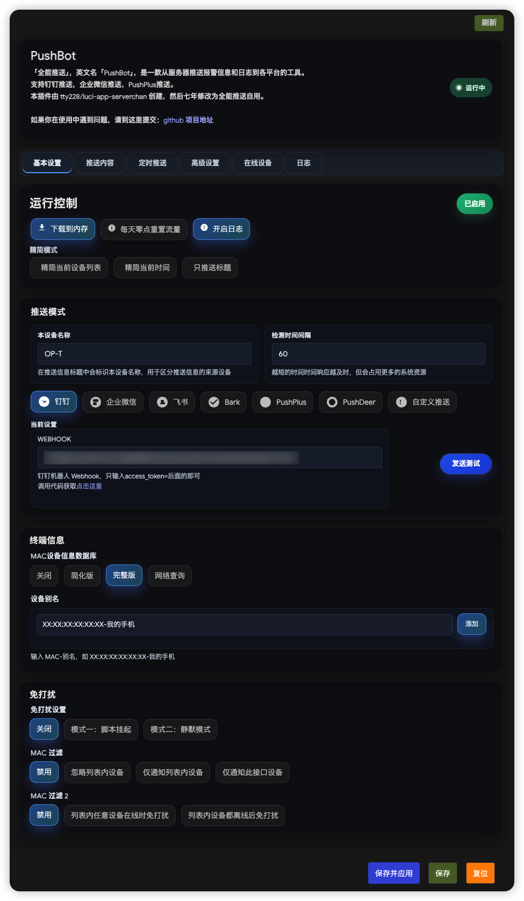
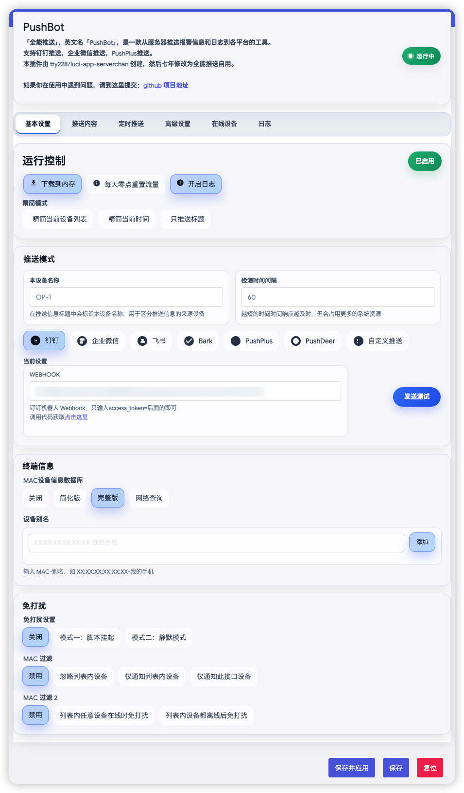
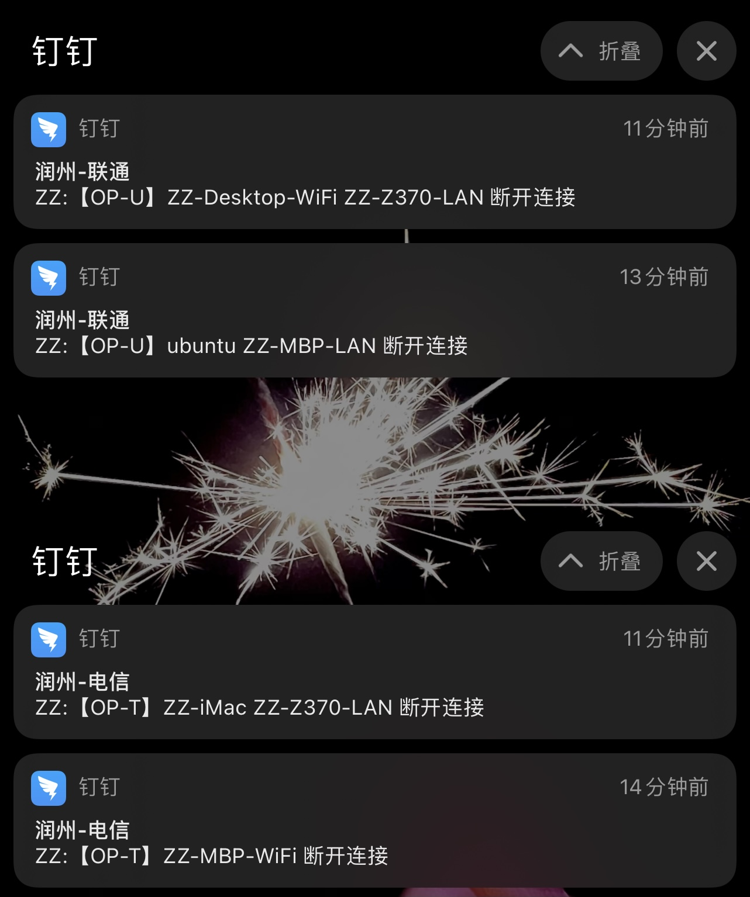
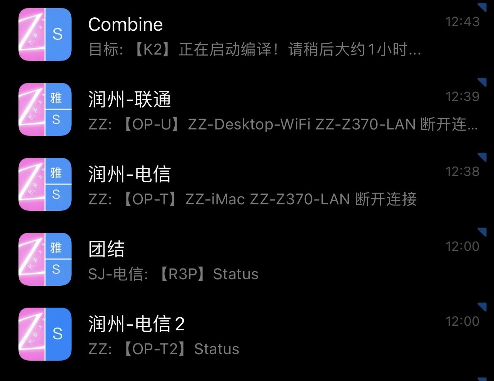
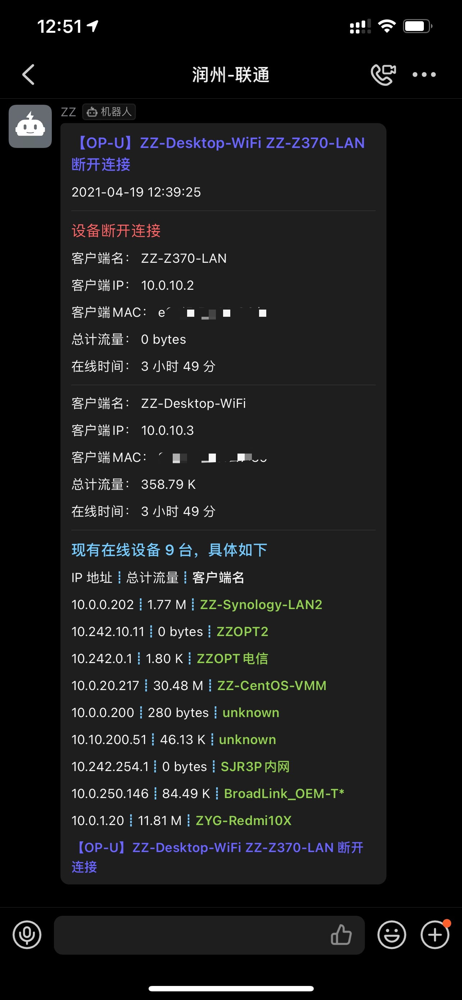

<div align="center">

# 🚀 luci-app-pushbot 全能推送

**路由器报警与日志推送工具** — 支持钉钉 · 企业微信机器人 · 企业微信应用（markdown / 文本 / 图文） · 飞书 · Bark · PushPlus · PushDeer · ntfy · Gotify · WxPusher 多渠道

[](https://github.com/naoki66/luci-app-pushbot/releases)
[](https://github.com/naoki66/luci-app-pushbot/issues)
[](https://github.com/naoki66/luci-app-pushbot/pulls)
[](https://github.com/naoki66/luci-app-pushbot/stargazers)
[](LICENSE)

**简体中文** | [English](README.en.md)

</div>

---

## 📖 申明

- 本插件由 [tty228/luci-app-serverchan](https://github.com/tty228/luci-app-serverchan) 原创，由 **然后七年** @zzsj0928 重新修改为本插件，适配钉钉机器人 API。
- 本插件工作在：**OpenWRT**
- 自 **v5.10** 起彻底去 Lua、去 CBI，采用**纯 ucode 架构**，仅支持 LuCI ≥ 23.05（详细支持平台与变更见下方更新日志）。

## 📝 更新日志

- **2026-10-13**（v6.01-r15，naoki66 原创修改）：新增企业微信应用推送渠道，并支持三种推送模式
  - 新增：**企业微信应用**——在「企业微信机器人」与「PushPlus」之间新增该渠道，填企业ID / 应用密钥 / 应用ID / 接收人即可推送到企业微信应用；原「企业微信」渠道改名**「企业微信机器人」**以区分群机器人与应用消息
  - 新增：**三种推送模式**——渠道内「消息类型」下拉可切换 **markdown / 纯文本 / 图文消息**，四个企微参数共用一份；详见 [企业微信应用（三种推送模式）](#-企业微信应用三种推送模式)
  - 新增：**失败原因诊断**——把接口 `errcode`/`errmsg` 落日志并翻译常见原因（可信IP、可见范围、参数超长、频率限制等），缺参数会明确报出缺哪一项
  - 兼容：企业微信应用 markdown 仅支持 `info`/`comment`/`warning` 关键字颜色，该渠道自动忽略界面自定义色值，避免色值标签被当文本显示

- **2026-09-27**（v6.01）：在线更新修复与配置管理
  - 修复+优化：**在线更新**——修复 IPK 更新失败、更新后界面丢失翻译与偶发卡死；等待 30 秒 → 10 秒装好即刷新；新增清除下载；安装一次后不再提示"允许未信任"
  - 新增：**配置管理**——一键恢复出厂设置，或仅重置系统项、保留当前推送渠道的 Token/UID/主题
  - 修复+优化：**总开关**——关闭后不再残留推送；「已启用」点击即保存并启停服务，无需再点保存
  - 修复：**渠道校验**——仅用 WxPusher/ntfy/Gotify 不再误报缺 Token；预览不再误报未改动项；测试按钮检测到改动会先提示保存再测
  - 优化：**界面**——卡片立体投影（亮/暗黑）、页面下移留白、移动端保存按钮换行；「时间间隔内流量限制」改名**「流量报警阈值」**
  - 新增：**OpenWrt 25.12 源手动编译**——Actions 手动触发，产物发布于 `OpenWRT25.12-*` Release

完整历史更新日志见 → [changelogs.md](changelogs.md)

## 🎯 功能概览

### 基本设置

| 模块 | 功能 |
|------|------|
| 运行控制 | 插件启用/禁用开关、精简模式（精简设备列表 / 当前时间 / 只推送标题） |
| 推送模式 | 支持 钉钉、企业微信机器人、企业微信应用（支持 markdown/文本/图文 三种消息类型）、飞书、Bark、PushPlus（全渠道）、PushDeer、ntfy、Gotify、WxPusher、自定义推送 等多种推送渠道 |
| 终端信息 | MAC 设备信息数据库（简化版 / 完整版 / 网络查询）、设备别名管理 |
| 免打扰 | 免打扰时段设置（脚本挂起 / 静默模式）、MAC 过滤（白名单 / 黑名单 / 接口过滤、在线 / 离线免打扰） |

### 推送内容

| 模块 | 功能 |
|------|------|
| 网络监控 | IPv4 / IPv6 变更通知（支持接口获取或 URL 获取）、设备上线/下线通知 |
| 性能监控 | CPU 负载报警及阈值、CPU 温度报警及阈值、设备异常流量检测及每分钟流量限制、异常流量免打扰及关注列表 |
| 安全监控 | Web 登录提醒、SSH 登录提醒、Web / SSH 错误尝试提醒、错误尝试次数、自动拉黑及拉黑时间、IP 白名单 / 黑名单 |

### 定时推送

| 模块 | 功能 |
|------|------|
| 定时任务 | 支持定时发送（每日最多三个时间点）和间隔发送 |
| 推送内容 | 系统运行情况、设备温度、WAN 信息、客户端列表 |
| 其他 | 推送标题自定义、全球互联检测超时时间、手动发送按钮 |

### 高级设置

| 模块 | 功能 |
|------|------|
| 设备监测 | 设备上线/离线检测超时时间、最大并发进程数、离线检测次数 |
| 温度监测 | 自定义温度读取命令（支持默认 / PVE 虚拟机 / 自定义命令）、PVE 宿主机 SSH 配置、温度测试 |
| 色彩定义 | 自定义主标题 / 成功 / 失败 / 客户端名 / 模块标题颜色（#RRGGBB），支持在线实时预览推送效果 |
| 无人值守 | 无人值守任务开关、仅在免打扰时段重拨、网络断开时操作（重启路由器 / 重新拨号 / 自动修复）、关注列表、定时重启（系统运行时间 / 网络在线时间触发）、重拨尝试获取公网 IP 及当天最大重试次数 |

### 在线设备

实时查看当前在线设备列表（主机名、MAC 地址、IP 地址、在线时间）

### 日志

实时查看推送日志，支持自动刷新和手动清除

## 📨 企业微信应用（三种推送模式）

企业微信应用**一个渠道内置三种推送模式**，在配置卡片的「消息类型」下拉中切换即可；企业ID / 应用密钥 / 应用ID / 接收人这四个参数由三种模式**共用一份**，无需重复填写。

| 消息类型 | 接口 msgtype | 正文形态 | 正文上限 | 适合场景 |
|:---|:---|:---|:---|:---|
| **markdown**（默认） | `markdown` | 应用卡片，支持 `####` 标题、`**` 加粗、`>` 引用，可用 `info` / `comment` / `warning` 关键字配色 | 2048 字节 | 日常状态推送，排版最好看 |
| **text** | `text` | 纯文本，不做任何渲染，以 `•` 作项目符号、`------` 作分隔线 | 2048 字节 | 兼容性优先，不怕渲染出错 |
| **mpnews** | `mpnews` | 图文消息：标题 + 正文 + 缩略图，点标题展开全文，正文按 HTML 排版 | — | 内容较长，希望像公众号文章一样阅读 |

> ⚠️ 应用消息正文上限是 **2048 字节**（群机器人渠道是 4096）。设备列表很长时可能被接口拒绝，此时日志会直接提示 `40058`。

### 配置步骤

1. 企业微信管理后台 → **我的企业** → 复制 **企业ID**
2. **应用管理** → 自建应用 → 复制 **AgentId** 与 **Secret**
3. 在同一页面把**路由器公网 IP 加入「企业可信IP」**，否则获取 `access_token` 会返回 `60020`
4. 「接收人」填写该应用**可见范围内**的成员账号，多个用 `|` 分隔（如 `ZhangSan|LiSi`），填 `@all` 则发给该应用全部成员
5. 选择「消息类型」；选 **mpnews** 时下方会多出「缩略图路径」，默认使用内置图 `/usr/bin/pushbot/api/logo.png`，也可自填路径（2MB 以内的 JPG/PNG，最佳 900×383）
6. 点**保存**后生效（消息类型属于排版设置，需服务重启重新读取）

### 失败原因诊断

该渠道会把接口返回的 `errcode` / `errmsg` 写入日志，并翻译成可读原因：

| errcode | 含义 |
|:---|:---|
| `40001` `40014` `41001` `42001` | 企业ID / 应用密钥错误，或 `access_token` 已失效 |
| `60020` | 路由器公网 IP 不在该应用的「企业可信IP」白名单中 |
| `81013` `60011` | 接收人不在该应用可见范围内，或 User ID 填写错误 |
| `40056` | Agent ID 无效，或该应用不属于当前企业 |
| `40058` | 参数不合法（User ID / Agent ID 格式），或正文超过 2048 字节 |
| `45009` | 接口调用超过频率限制，请降低推送频率 |

## 🔧 编译集成

本仓库是 **LuCI 应用仓库**，包文件（`Makefile`、`root/`、`ucode/`、`po/`）直接位于**仓库根目录**，没有 `luci-app-pushbot/` 子目录。接入 OpenWrt / ImmortalWrt 源码树有两种方式。

### 方式一：克隆到 `package/`（最省事，推荐）

```bash
cd openwrt                    # 你的 OpenWrt / ImmortalWrt 源码根目录
git clone --depth=1 https://github.com/naoki66/luci-app-pushbot package/luci-app-pushbot
make menuconfig               # LuCI → Applications → luci-app-pushbot
```

### 方式二：作为 feed 集成

> 本仓库的包位于仓库根，而 feed 要求每个包位于子目录中，因此用 `src-link` 在外面套一层目录再链进来：

```bash
mkdir -p /usr/src/pushbot-feed
git clone --depth=1 https://github.com/naoki66/luci-app-pushbot /usr/src/pushbot-feed/luci-app-pushbot
```

在源码根目录 `feeds.conf.default` 末尾追加：

```
src-link pushbot /usr/src/pushbot-feed
```

```bash
./scripts/feeds update pushbot
./scripts/feeds install -a -p pushbot
make menuconfig               # LuCI → Applications → luci-app-pushbot
```

## 📥 下载

- [luci-app-pushbot Releases](https://github.com/naoki66/luci-app-pushbot/releases)

### 致谢引用

本项目基于或参考了以下开源项目，在此一并致谢：

- [zzsj0928/luci-app-pushbot](https://github.com/zzsj0928/luci-app-pushbot) —— 本仓库的上游原始项目
- [tty228/luci-app-serverchan](https://github.com/tty228/luci-app-serverchan) —— 本插件的最初来源
- [tty228/luci-app-wechatpush](https://github.com/tty228/luci-app-wechatpush) —— 企业微信应用推送渠道的参考实现
- [brvphoenix/wrtbwmon](https://github.com/brvphoenix/wrtbwmon) —— 流量统计
- [brvphoenix/luci-app-wrtbwmon](https://github.com/brvphoenix/luci-app-wrtbwmon) —— 流量统计 LuCI 界面

## 💡 说明

- 精力有限，新功能看需开发；
- 欢迎各种代码提交；
- 潘多拉系统、或不支持 sh 的系统，请将脚本开头 `#!/bin/sh` 改为 `#!/bin/bash`，或手动安装 `sh`；
- 提交 bug 时请尽量带上设备信息、日志与描述（如执行 `/usr/bin/pushbot/pushbot` 后的提示、日志信息、`/tmp/pushbot/ipAddress` 文件信息）。

## 已知问题

- 直接关闭接口时，该接口的离线设备会忽略检测；
- 部分设备无法读取到设备名，脚本使用 `cat /var/dhcp.leases` 命令读取设备名，如果 dhcp 中不存在设备名则无法读取（如二级路由设备、静态 IP 设备），请使用设备名备注。

---

## 🖼 显示效果

- **新的现代 UI 设计，兼容暗黑模式，更合理的架构**




<br><br/>

- **通知栏：直接显示推送主题，一目了然，按设备不同分组显示**



<br><br/>

- **消息列表：直接显示最新推送的标题**



<br><br/>

- **消息内容：直接显示所有推送信息，不用二次点开再查看**



## 🍡赏我一把 Token
**制作不易，感谢支持**

